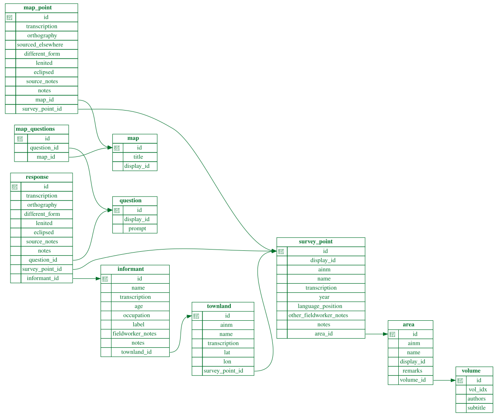

# Digitisation of the Linguistic Atlas and Survey of Irish Dialects

## Background

This project continues work by Eoghan Mac Éinrí, Ciarán Ó Duibhín and Brian Mac
Lochlainn, described
[here](https://www.teanga.info/oduibhin/oideasra/lasid/doc/lasid.htm) by
Ciarán.

As Ciarán puts it:

> The Linguistic Atlas and Survey of Irish Dialects (LASID) is a 4-volume work
> by [Heinrich Wagner](https://www.dib.ie/biography/wagner-heinrich-hans-a8837), first published by the Dublin Institute for Advanced Studies between 1958 and 1969, containing the responses, in phonetic notation, to 1175 questions as to the local Gaelic language equivalents of selected English words and phrases, at some 90 locations in Ireland, 7 in Scotland, and 2 in the Isle of Man.
>
> Volume 1 consists of 300 maps, each of which displays, for the Irish and Manx locations, the responses to one, two or three questions (230, 69 and 1 map respectively). Each map is headed by the English words or phrases used in the question(s) mapped, and by the most common Gaelic wordings (in normal spelling) which occur in the responses to those questions. We here treat a multi-question map as a number of separate maps, and thus we have 371 maps in total.

The previous work involved digitisation of the transcriptions in the Volume 1
maps by Eoghan Mac Éinrí, for use with a computer retrieval system developed by
Ciarán Ó Duibhín and Brian Mac Lochlainn. Eoghan Mac Éinrí's
[PhD thesis](https://pure.qub.ac.uk/en/studentTheses/computer-aided-contributions-to-the-study-of-irish-dialects/)
describes this in greater detail[^digitisation]. Further work by Ciarán is
described in the first link[^ciarán].

This project aims to continue this work by digitising more parts of the LASID,
making the data more accessible to modern computing environments, and taking
advantage of advances in technology that allow for easier data visualisation
and interaction.

Much of the Scottish fieldwork was conducted by Colm Ó Baoill. These
transcriptions are not included in the Volume 1 maps, but the corresponding
responses are given in Volume 4, along with the responses for the 1175 survey
questions.

Specific practical goals of this project are as follows:

* ✅ to build a queryable database containing the previously digitised transcriptions from
the Volume 1 maps
* ⏳ to digitise the Scottish transcriptions for the Volume 1 maps, not included
in the previous digitisation
* ✅ to add longitude and latitude of each location surveyed, for generation of
maps
* ✅ to add biographical information about the speakers surveyed
* ⏳ to add orthographic representations of the phonetic transcriptions,
for generation of lexical isoglosses and other lexical analysis
* ✅ to allow addition of transcriptions from survey responses to questions not
shown in the Volume 1 maps
* ⬜ to build a webpage where the database information is displayed on
interactive maps

<details><summary>Click for progress on orthography and Scottish transcriptions</summary>

* 53 / 371 maps have orthographic representations added
* 48 / 371 maps have Scottish transcriptions added

| Map number   | Title  | Orthography   | Scottish transcriptions  |
|---|---|---|---|
| 1   |  I sold | ✓  | ✓  |
| 2   |  cattle | ✓  |  ✓ |
| 3a  |  cow| ✓  | ✓  |
| 3b  |  bulls  |   | ✓  |
| 4   |  tail   |   | ✓  |
| 5   |  castrating VN  | ✓   | ✓  |
| 6   |  slime, as of cow in heat   |   | ✓  |
| 7a  |  bullock|   | ✓  |
| 7b  |  calf   |   | ✓  |
| 8   |  (the cow is) in heat   |   | ✓  |
| 9a  |  heifer |   | ✓  |
| 9b  |  thieving   |   |  ✓ |
| 10a |  agut prep. pron. 2. p. sg. |   | ✓  |
| 10b |  aca, ocú prep. pron. 3. p. pl. |   | ✓  |
| 11  |  barking|   | ✓  |
| 12  |  (she is) chewing the cud   |   | ✓  |
| 13a |  horn of cow|   | ✓  |
| 13b |  sick   |   | ✓  |
| 14  |  tied   |   | ✓  |
| 15  |  I shall tie|   | ✓  |
| 16  |  grazing|   | ✓  |
| 17  |  calling|   | ✓  |
| 18  |  teats of cow's udder   |   | ✓  |
| 19  |  milking VN |   | ✓  |
| 20  |  new milk   |   | ✓  |
| 21a |  churn  |   | ✓  |
| 21b |  butter |   | ✓  |
| 22  |  churn-dash |   | ✓  |
| 23a |  vessel |   | ✓  |
| 23b |  (your) choice  |   |   |
| 24  |  do you want (a drink)  |   |   |
| 25  |  (we do not need) anything  |   |   |
| 26a |  sheep sg.  |   |   |
| 26b |  lamb   |   |   |
| 27a |  ram|   |   |
| 27b |  sheep shears   |   |   |
| 28a |  astray |   |   |
| 28b |  smothered V. adj.  |   |   |
| 29a |  goat   |   |   |
| 29b |  he-goat|   |   |
| 30  |  helping VN |   |   |
| 31  |  boar   |   |   |
| 32  |  suckling pigs pl.  |   |   |
| 33  |  rooting, as of pigs VN |   |   |
| 34  |  smallest pigling of a litter   |   |   |
| 35  |  chickens   |   |   |
| 36a |  plumage, as of hens|   |   |
| 36b |  feathers pl.   |   |   |
| 37a |  (the fox) killed   |   |   |
| 37b |  (he) will kill |   |   |
| 38  |  (the hens are) at the gate |   |   |
| 39  |  more (bread)   |   |   |
| 40  |  dozen  |   |   |
| 41  |  cock   |   |   |
| 42  |  fox|   |   |
| 43  |  wings pl.  |   |   |
| 44  |  geese pl.  |   |   |
| 45a |  egg sg. 1–22: masc., 23–87: fem.   |   |   |
| 45b |  egg gen. sg. 1–22: masc., 23–87: fem.  |   |   |
| 45c |  eggs pl.   |   |   |
| 46  |  a soft egg, i.e. an egg laid without the shell |   |   |
| 47  |  (he is) as cute (as a fox) |   | ✓  |
| 48  |  duck   |   |   |
| 49  |  bee|   |   |
| 50  |  we bought 1. pl. pret. |   |   |
| 51  |  I shall buy 1. sg. fut.|   |   |
| 52a |  horse  |   |   |
| 52b |  mare   |   |   |
| 53a |  foal sg.   |   |   |
| 53b |  foals pl.  |   |   |
| 54  |  mane (of the horse)|   |   |
| 55  |  running VN |   |   |
| 56  |  dog| ✓  | ✓  |
| 57  |  horse shoes pl.|   |   |
| 58  |  pannier-baskets|   |   |
| 59  |  shooting VN|   |   |
| 60  |  rubbing VN |   |   |
| 61  |  sewing VN  |   |   |
| 62  |  thimble|   |   |
| 63  |  slippery   |   |   |
| 64  |  knitting   |   |   |
| 65  |  digging VN | ✓  |  ✓ |
| 66a |  hole sg.   |   |   |
| 66b |  holes pl.  |   |   |
| 67  |  knitting needle|   |   |
| 68  |  at all |   |   |
| 69  |  spinning-wheel |   |   |
| 70  |  tongue |   |   |
| 71  |  soap   |   |   |
| 72  |  cabbage|   |   |
| 73  |  he thinks (that I am a fool)   |   |   |
| 74  |  fart   |   |   |
| 75  |  floor  |   |   |
| 76a |  bread  |   |   |
| 76b |  loaf   |   |   |
| 77  |  (he) was found | ✓  | ✓  |
| 78a |  pot|   |   |
| 78b |  new|   |   |
| 79  |  dreaming VN|   |   |
| 80  |  on the road|   |   |
| 81a |  light  |   |   |
| 81b |  heavy  |   |   |
| 82  |  we get 1. pl. pres.|   |   |
| 83  |  dirty  |   |   |
| 84  |  suit of clothes|   |   |
| 85  |  also   |  ✓ | ✓  |
| 86  |  you will get 2. sg. fut.   |   |   |
| 87  |  sleeve |   |   |
| 88  |  food   | ✓  |   |
| 89  |  scarce |   |   |
| 90  |  too much (food is bad) |   |   |
| 91  |  did you eat? (I did not eat)   |   |   |
| 92  |  your fill  |   |   |
| 93  |  pennies pl.|   |   |
| 94  |  something  |   |   |
| 95  |  earning VN |   |   |
| 96  |  half-crown |   |   |
| 97  |  empty  |   |   |
| 98  |  sugar  |   |   |
| 99  |  porridge   |   |   |
| 100 |  much   |   |   |
| 101 |  brother|   |   |
| 102 |  (give me something) to eat |   |   |
| 103 |  sister |   |   |
| 104 |  game   |   |   |
| 105 |  daughter   |   |   |
| 106 |  grandmother|   |   |
| 107 |  people (of Ireland)|   |   |
| 108 |  ten (people)   |   |   |
| 109 |  deep   |   |   |
| 110a|  woman pl.  |   |   |
| 110b|  talking|   |   |
| 111 |  many an (Irishman went to America) |   |   |
| 112 |  harm   |   |   |
| 113 |  England|   |   |
| 114 |  Irish  |   |   |
| 115 |  complaining|   |   |
| 116 |  neck   |   |   |
| 117a|  face   |   |   |
| 117b|  forehead   |   |   |
| 118 |  did you hear?  |   |   |
| 119 |  hearing VN |   |   |
| 120a|  head gen. sg.  |   |   |
| 120b|  head nom. sg.  |   |   |
| 121 |  (I have to comb my hair every morning) before I go (to school) |   |   |
| 122a|   deaf |   |   |
| 122b|   glass|   |   |
| 123 |   I shall see  |✓   | ✓  |
| 124 |   blind|   |   |
| 125 |   seeing VN lenited|   |   |
| 126 |   looking VN   |   |   |
| 127 |   sight|   |   |
| 128 |   snoring VN   |   |   |
| 129 |   fool |   |   |
| 130 |   toothache|   |   |
| 131 |   did you feel, do you feel (the pain) |   |   |
| 132a|   bones pl.|   |   |
| 132b|   back |   |   |
| 133 |   hip(s)   |   |   |
| 134 |   thumb|   |   |
| 135 |   barefooted   |   |   |
| 136 |   finger-nails pl. |   |   |
| 137 |   we (I) shall wash|   |   |
| 138 |   throat   |   |   |
| 139 |   liver| ✓  | ✓  |
| 140 |   lungs|   |   |
| 141 |   bed  |   |   |
| 142 |   what is on your mind?|   |   |
| 143 |   (she is sitting on her) hunkers  |   |   |
| 144 |   closing VN   | ✓  | ✓  |
| 145 |   sore |   |   |
| 146 |   open V. adj. |   |   |
| 147a|   house sg.|   |   |
| 147b|   houses pl.   |   |   |
| 148 |   lying VN |   |   |
| 149 |   gable of the house   |   |   |
| 150 |   walls pl.|   |   |
| 151 |   windows pl.  |   |   |
| 152 |   (I was) awake|   |   |
| 153 |   chairs pl|   |   |
| 154 |   numbness, ‘pins and needles’ |   |   |
| 155 |   I shall sit  1. sg. fut. |   |   |
| 156 |   table|   |   |
| 157 |   (It is likely) that he will not come |   |   |
| 158 |   rest yourselves! 2. pl.  |   |   |
| 159 |   heather  |   |   |
| 160a|   loft |   |   |
| 160b|   smoke|   |   |
| 161 |   a fetter between fore and hind feet  |   |   |
| 162 |   wedge|   |   |
| 163 |   mistake, forgetting  |   |   |
| 164 |   fire gen. sg.| ✓  | ✓  |
| 165a|   spoon|   |   |
| 165b|   knife|   |   |
| 166 |   tongs|   |   |
| 167a|   sods pl. |   |   |
| 167b|   turf gen. sg.| ✓  | ✓  |
| 168 |   chimney  |   |   |
| 169 |   yet  |   |   |
| 170 |   a fragment of dry turf   |   |   |
| 171 |   plough   |   |   |
| 172 |   only for (him we would all have been drowned)|   |   |
| 173a|   grass|   |   |
| 173b|   load, burden |   |   |
| 174 |   footing (turf)   |   |   |
| 175 |   (this bucket is) for (water) |   |   |
| 176a|   timber   |   |   |
| 176b|   ploughing VN | ✓  | ✓  |
| 177a|   to sharpen   |   |   |
| 177b|   reaping-hook |   |   |
| 178 |   turned V. adj.   |   |   |
| 179 |   turn around! ipv. sg.|   |   |
| 180a|   garden   |   |   |
| 180b|   potatoes pl. |   |   |
| 181a|   spade|   |   |
| 181b|   boiled V. adj.   |   |   |
| 182a|   seed |   |   |
| 182b|   potato slits pl. |   |   |
| 183a|   plentiful|   |   |
| 183b|   ripe |   |   |
| 184 |   wheat|   |   |
| 185 |   sheafs pl. (in some places sg.)  |   |   |
| 186 |   potato sprouts   |   |   |
| 187a|   threshing VN |   | ✓  |
| 187b|   handle of a flail|   |   |
| 188 |   visiting at night|   |   |
| 189 |   barn |   |   |
| 190 |   singing VN   |   |   |
| 191a|   Lent |   |   |
| 191b|   dance|   |   |
| 192 |   (they) will be married   |   |   |
| 193a|   (he) will be buried  |   |   |
| 193b|   coffin   |   |   |
| 194a|   smith|   |   |
| 194b|   anvil|   |   |
| 195 |   melting VN   |✓   |   |
| 196a|   wake | ✓  | ✓  |
| 196b|   funeral  | ✓  | ✓  |
| 197 |   when will you go (home)? |   |   |
| 198 |   (people) did not go  |   |   |
| 199a|   scholars pl. |   |   |
| 199b|   rich |   |   |
| 200 |   a young girl |   |   |
| 201 |   hard |   |   |
| 202 |   everybody (knows)|   |   |
| 203 |   chapel   |   |   |
| 204 |   it was said  | ✓  | ✓  |
| 205 |   fortnight|   |   |
| 206a|   saying VN|   |   |
| 206b|   devil|   |   |
| 207 |   Palm Sunday  |   |   |
| 208 |   flea sg. or pl.  |   |   |
| 209a|   ant sg. or pl.   |   |   |
| 209b|   moth sg. or pl.  |   |   |
| 210 |   maggots pl.  |   |   |
| 211 |   mice pl. |   |   |
| 212 |   butterfly|   |   |
| 213 |   hare |   |   |
| 214 |   curlew   |   |   |
| 215a|   pigeon   |   |   |
| 215b|   hawk |   |   |
| 216 |   snails pl.   |   |   |
| 217 |   seagull  |   |   |
| 218 |   crane|   |   |
| 219 |   thunder  |   |   |
| 220 |   snipe|   |   |
| 221 |   it is raining|   | ✓  |
| 222 |   shelter  | ✓  |   |
| 223a|   shower   |   |   |
| 223b|   wind |   |   |
| 224 |   rainbow  |   |   |
| 225 |   (he is) gone |   |   |
| 226 |   (go out) quickly |   |   |
| 227 |   fatter   |   |   |
| 228a|   dew  |   |   |
| 228b|   moon |   |   |
| 229 |   stars pl.|   |   |
| 230 |   (the sun is) shining | ✓  |   |
| 231a|   (of) the summer gen. sg. |   |   |
| 231b|   winter   | ✓  | ✓  |
| 232 |   (the sun is) rising  |   |   |
| 233a|   a quarter of a year  |   |   |
| 233b|   spring   |   |   |
| 234 |   (ten) minutes|   |   |
| 235 |   (ten minutes) past (five)|   |   |
| 236 |   April|   |   |
| 237 |   late |   |   |
| 238 |   waiting VN   |   |   |
| 239 |   (I am) middling  |   |   |
| 240 |   (I) know (him) well  |   |   |
| 241a|   (he) made|   |   |
| 241b|   coming VN|   |   |
| 242 |   why did you not come?|   |   |
| 243a|   (he) comes   |   |   |
| 243b|   (wait till he) comes!|   |   |
| 244 |   how are you? |   |   |
| 245a|   hill, mountain   |   |   |
| 245b|   boundary |   |   |
| 246a|   there|   |   |
| 246b|   under me |   |   |
| 247 |   (I am in a) hurry|   |   |
| 248a|   wood |   |   |
| 248b|   trees pl.|   |   |
| 249 |   nettle   |   |   |
| 250 |   he is afraid of me   |   |   |
| 251 |   before them  |   |   |
| 252 |   a short cut  |   |   |
| 253 |   (the shoes) do not fit (me)  |   |   |
| 254 |   doing, making VN |   |   |
| 255 |   tired|   |   |
| 256 |   (he) makes   |   |   |
| 257a|   book |   |   |
| 257b|   poteen i.e. whiskey made in private stills   |   |   |
| 258a|   (wait till) I am (at home)   |   |   |
| 258b|   (he) was caught  | ✓  | ✓  |
| 259a|   surprise |   |   |
| 259b|   to them  |   |   |
| 260 |   lazy |   |   |
| 261 |   tide |   |   |
| 262 |   very busy|   |   |
| 263 |   limekiln |   |   |
| 264 |   change (on the moon) |   |   |
| 265 |   sword|   |   |
| 266a|   strand   |   |   |
| 266b|   brink|   |   |
| 267 |   cliffs   |   |   |
| 268 |   smell| ✓  | ✓  |
| 269a|   seaweed  |   |   |
| 269b|   searods  |   |   |
| 270a|   valley   |   |   |
| 270b|   boats pl.| ✓  | ✓  |
| 271 |   periwinkles  |   |   |
| 272 |   oars pl. |   |   |
| 273a|   fishing nets pl. |   |   |
| 273b|   (the nets are) entangled |   |   |
| 274a|   counting VN  |   |   |
| 274b|   dividing VN  |   |   |
| 275a|   fishing-lines|   |   |
| 275b|   frame of fishing-line|   |   |
| 276 |   the gills of a fish  |   |   |
| 277 |   hook |   |   |
| 278 |   folding VN   | ✓  | ✓  |
| 279 |   (he has) no patience |   |   |
| 280a|   bridge   |   |   |
| 280b|   river|   |   |
| 281 |   (they) were killed   |   |   |
| 282 |   (you) will be drowned|   |   |
| 283 |   mackerel |   |   |
| 284a|   herring  |   |   |
| 284b|   salmon   |   |   |
| 285 |   I did not notice him |   |   |
| 286a|   measuring VN |   |   |
| 286b|   trade|   |   |
| 287 |   dogfish  |   |   |
| 288 |   the fur of a donkey  |   |   |
| 289a|   rushes   |   |   |
| 289b|   suspicion|   |   |
| 290 |   I met him (on the road)  |  ✓ |   |
| 291 |   (maybe) we would not meet each other (again) |   |   |
| 292a|   forty|   |   |
| 292b|   shillings|   |   |
| 293 |   (I heard) what you said  |   |   |
| 294 |   if you went  |   |   |
| 295a|   show me (the house)! |   |   |
| 295b|   nits |   | ✓  |
| 296 |   he used to come  |   |   |
| 297 |   (we will wash) ourselves |   |   |
| 298 |   he died suddenly | ✓  | ✓  |
| 299 |   (I will eat) whatever you will give me   |   |   |
| 300a|   stubble  |   |   |
|  300b|   moss | | |

</details>

The LASID captures dialectal diversity, both lexical and phonetic, across an
area where many of the local dialects have since become extinct. I hope that
this work will be useful not only to linguists, but to anyone who might
have a personal, not necessarily academic, interest in the dialect of a
particular place.

## Technical details

### Summary

The LASID data is stored in a SQLite relational database. As the data is
static and suitably small, this is version controlled in a plain-text
[`.sql`](create.sql)
file (containing the schema, geographical information, and informant details),
and [`.csv`](data/) files containing the transcription information.

A script is provided for building the SQLite database.

The database can then be queried, for example, to retrieve all transcriptions
and survey point IDs where locations where the word _tórramh_ is used for
funeral:

```sql
sqlite> select survey_point.display_id, map_point.transcription
   ...> from survey_point
   ...> join map_point on survey_point.id = map_point.survey_point_id
   ...> join map on map_point.map_id = map.id
   ...> where map.title = "funeral"
   ...> and map_point.orthography = "tórramh";
64|t+õː+r+ʰ+ə
65|t+ɔː+r+ʰ+u
66|t+ɔː+r+u
68|t+ǫː+r+ʰ+ŭ
69|t+ɔː+r+ʰ+u
71|t+ɔː+r+ʰ+u
72|t+ɔː+r+u
72|t+ɔː+r+ʰ+u
73|t+ǫː+r+u
74|t+ɔː+r+h+u+φ
75|t+ɔ̨ː+r·+u
76|t+ɔː+r+u
77|t+ɔː+r+u
78|t+ɔː+r+u
79|t+ɔː+r+ʰ+u+φ
80|t+ɔː+r+ʰ+ŭ
81|t+ɔː+r·+u+φ
82|t+ɔː+r+u
83|t+ɔː+r+u
83|t+ǫː+r+h+uː
84|t+oː+r+ʰ+ɛ+ŭ
85|t+ɔː+r+ŭ
86|t+ɔː+r+u+h+ˀ
```

The `+` character is used as a delimiter between phonetic symbols denoting one
sound, which are
often composed of more than one unicode character, e.g. `ɔː` or `ɴ′`. This
assists with processing when extracting individual sounds, and will help with
display on the webpage, for example to allow users to view transcriptions
containing a particular sound.

To retrieve information about the informants for a particular survey point:

```sql
sqlite> select informant.name, informant.transcription, age, occupation
   ...> from informant
   ...> join townland on informant.townland_id = townland.id
   ...> join survey_point on townland.survey_point_id = survey_point.id
   ...> where survey_point.display_id = "a";
John Henderson|i.ən mə kẹ.nrïk′|75|retired farmer
Donald Craig|ˈdǫːɫ ək ɑ̆ ˈxɑ’rɪg′|61|farmer
John Robertson|ˈi.ən′ mək ˈrǫːḅ|90|carpenter
```

The phonetic transcriptions of placenames and personal names have not been
delimited with `+`, though this could be done as future work if there is desire
to be able to process these in a similar way to the survey response
transcriptions.

To retrieve all the unique words collected in response to a survey
question[^frogs]:

```sql
sqlite> select distinct orthography from response
   ...> join question on response.question_id = question.id
   ...> where question.prompt like "frog%"
   ...> order by orthography;
breallach lathaí
breallach na lathaí
cnádán
crónán
crúbán claidhe
frog
frogan
froganna
frogannaí
froig
froisg
frosg
frús
lapadán
lapadán lathaí
lapadóir
leumnachan
lioprachán
loipreachán
losgann
losgáin
luascán lathaí
lúbar lathaí
mulla-mhóthagan
mulla-móthag
na froganna
na frogannaí
na gcnádán
tortán
```

### Installation and setup

You will need:

* [uv](https://docs.astral.sh/uv/getting-started/installation/), which will install a Python toolchain if
  you don't already have one, and will manage dependencies
* SQLite, which comes installed on many Linux and macOS distributions, and can
  be downloaded [here](https://www.sqlite.org/download.html) for those
  operating systems as well as Windows.

With this basic toolchain in place, you can build the database with `uv run poe
build_db`. The database will be saved as `lasid.db`. You can start an
interactive SQLite session with `sqlite3 lasid.db`.

### Database schema



The `map_questions` table relates Volume 1 maps to specific questions/prompts
in the survey. The `map_point` table describes a phonetic point on the Volume 1
maps.

## Example analysis script uses

### Word maps

Lexical maps can also be generated using
[`analysis/word_map.py`](analysis/word_map.py), e.g.:

```shell
uv run analysis/word_map.py --map_title cattle --cmap Dark2 --markers "eallach:P,beithidhigh:o,ainmhithe:^,crodh:s,bá:d" --eq "crodh,an crodh"
```

<p align="center">


</centre>

With careful selection of the markers and the order of the plotting, the
scatter plot can be made to show when there is more than one word at a
location, but this is definitely a weakness of this plot.

The text plot tends to show this more obviously, but can be harder to read.

The script used here has various options to attempt to make the plots
colourblind-friendly. It can be challenging to do so as most qualitative colour
palettes that are friendly to dichromatic colourblindness are only friendly
when there is no more than 3 or 4 classes. Colourblind-friendly palettes can
also be lower in contrast for the majority of the population that is not
colourblind. Different markers, and the combination of word maps and scatter
maps, hopefully help with making these plots accessible to colourblind people.

Ultimately these plot will be better viewed on interactive maps, which 
could allow for users choosing their own colour palettes, as well as displaying
denser information on the same geographical location (not only multiple
phonetic records/words, but information about informants and the
geographical area).

Here is another example of using this script, where the markers are
automatically chosen (only scatter plot shown):

```shell
uv run analysis/word_map.py --map_title also --cmap Dark2 --grouped "fosta,fostacht.chomh maith,comh maith,gomh maith.freisin.cuideachd.neesht,féin" --num-friendly-cols 3
```

<p align="center">

</centre>

The words _neesht_ and _féin_ are grouped in the same colour to preserve
dynamic range in the colourmap, given they only have one data point each. The
first three colours in this palette are colourblind-friendly, hence the use of
additional markers for the remaining classes. This does add some visual noise,
but I think it is minimal and perhaps worth it for the accessibility gains. The
`uv run analysis/word_map.py --help` gives more details on the configuration
&ndash; it is possible for the same set of markers to be used for every colour.

Any feedback from colourblind people is appreciated.

### Same word, different meaning geographically

```shell
uv run analysis/same_word_diff_usage.py -word tórramh -word tórradh
```

<p align="center">

<p align="center">

The distinction between _tórramh_ and _tórradh_ is etymologically dubious to me
and I may reconsider the way I have labelled the data.

### Comparing realisations of ⟨ó⟩

The script [`analysis/long_o_maps.py`](analysis/long_o_maps.py) produces maps
displaying information about the realisation of ⟨ó⟩, for example:

<p align="center">

</p>

Note that vowel length and nasalisation are ignored in this map.

### Analysis blog posts

* [Exploring the LASID: Gaelic words for "also"](https://mcla.ug/fosta.html)

[^digitisation]: The digitisation of the transcriptions is very arduous (though
perhaps less so now than in the 1970s). I am very grateful to be able
to build on this previous work. I have experimented with OCR but it is
challenging with so many diacritics. It would need very careful checking of the
results. We do, however, have lots of labelled training data thanks to the
previous work, so it may make sense to revisit OCR.

[^ciarán]: Thank you to Ciarán for providing the transcription data, background
information and encouragement.

[^frogs]: Further frog words can be found at
[mcla.ug/froganna.html](https://mcla.ug/froganna.html).
